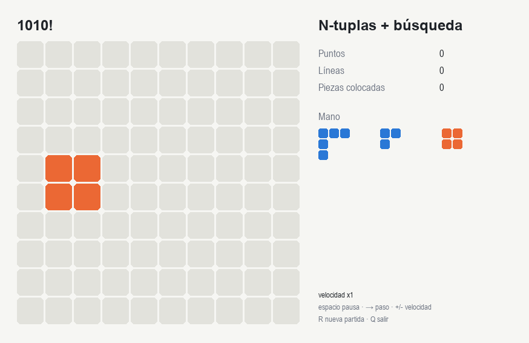
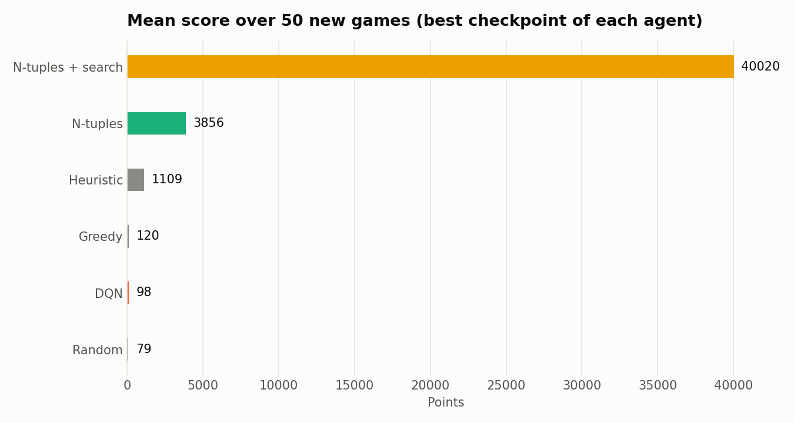
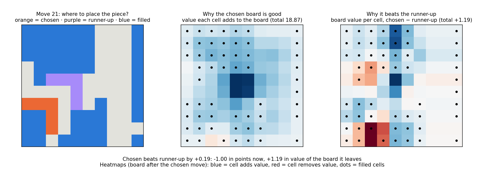
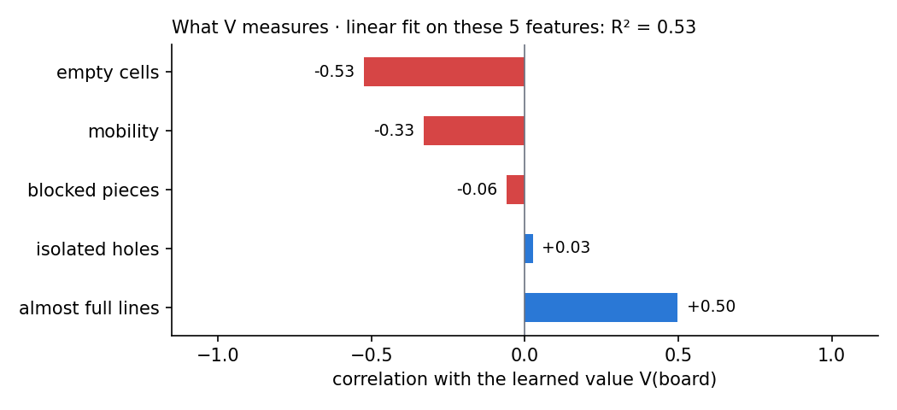

# 1010! Reinforcement Learning

Reinforcement learning agents that learn to play **1010!**: place pieces on a 10×10 board, clear full rows and columns, and survive as long as possible. Everything runs on CPU.

<p align="center">
  
</p>

<p align="center"><em>N-tuple network + one-step search playing the full game.</em></p>

## Agents

| Agent                     | Idea                                                                                           |
| ------------------------- | ---------------------------------------------------------------------------------------------- |
| Random, Greedy, Heuristic | Baselines: random move, most lines cleared, hand-made board score                              |
| Tabular Q-learning        | One Q-value per visited (state, action); only feasible on small boards                         |
| DQN                       | Double DQN with action masking, replay buffer and target network                               |
| N-tuples                  | TD(0) on afterstates with an n-tuple network that shares weights across the 8 board symmetries |
| N-tuples + search         | The trained n-tuple network plus a one-step lookahead using the pieces left in hand            |

All agents use the same reward: the points of each move (cells placed + line bonus).

## Results

Full game: 10×10 board, all 19 pieces, hand of 3, at most 1000 pieces per game. DQN and n-tuples get the same budget of 1M training steps; every agent is evaluated on the same 50 games.

<p align="center">
  
</p>

| Agent                 | Mean score | Games that reach the 1000-piece cap |
| --------------------- | ---------: | ----------------------------------: |
| **N-tuples + search** |   **8542** |                             **90%** |
| N-tuples              |       3418 |                                 14% |
| Heuristic             |       1109 |                                   – |
| Greedy                |        120 |                                   – |
| DQN                   |         98 |                                  0% |
| Random                |         79 |                                   – |

_– : not measured for the baselines._

**N-tuples + search survives the whole game in 90% of the games**, so its mean score is a
lower bound: the cap stops the game, not the agent. Even so, it scores 7.7× the
hand-crafted heuristic.

The n-tuple network generalises across boards it has never seen, while the DQN does not learn in this setting. On a small deterministic version (5×5, one piece) the ranking flips and the DQN wins, since it can memorise a sequence that never loses. All figures are in [`results/`](results/).

## Project structure

```
src/tenten/
  game/        rules engine and Gymnasium environment
  agents/      baselines, tabular, DQN, n-tuples, and a registry to load any of them
  training/    one training loop per agent, with its default CONFIG
  evaluation.py, tracking.py (MLflow), plots.py
scripts/       command-line entry points
tests/         mirrors src/tenten
results/       experiment figures, GIFs and summary.json
```

## Usage

Requires Python 3.10+ and [uv](https://docs.astral.sh/uv/).

```bash
uv sync

# Compare all agents (figures go to results/<setup>/)
uv run python scripts/experiment.py --setup 10x10_all
uv run python scripts/experiment.py --setup 5x5_small_L

# Train a single agent with its default configuration
uv run python scripts/train.py --agent ntuple      # tabular | dqn | ntuple

# Watch an agent play (or save a GIF with --gif file.gif)
uv run python scripts/visualize.py --agent ntuple --search

# Experiment tracking and tests
uv run mlflow ui --backend-store-uri sqlite:///mlflow.db
uv run pytest
```

## Explainability

The n-tuple network is an **additive model**: V(board) is just the sum of one weight per
tuple (400 tuples). That makes its decisions explainable **exactly**, without the
approximations that saliency methods need for deep networks.

### Why this move? (local explanations)

**Per-cell contribution map.** Each tuple's active weight is shared equally among its
cells; summing per cell gives a 10×10 map whose total is exactly V(board). Blue cells
raise the value of the board, red cells lower it.

_Note:_ the decomposition of V into tuple weights is exact; splitting each weight equally
among the cells of its tuple is a convention for drawing the map (other splits would also
add up to V), so the map is exact in total but one of several valid per-cell attributions.

**Contrastive explanation.** The agent scores each move as `reward + γ·V(afterstate)`.
Comparing the chosen move with the runner-up, the score gap splits exactly into

    score gap = reward gap + Σ_cells γ·(contribution_chosen − contribution_runner-up)

so we can see whether a move was chosen for its immediate points or for the board it
leaves, and which areas of that board made the difference.



_Left: current board with the chosen move (orange) and the runner-up (purple). Middle:
contribution of each cell to the value of the chosen board. Right: per-cell value
difference between the two resulting boards._

Here the agent gives up an immediate line clear (−1.00 in points) because the board it
leaves is worth +1.19 more: the gain comes from the top-centre columns, while the area
around the placed piece counts against it.

### What has the network learned? (global explanation)

A **linear probe** checks how well five interpretable features explain V on 6,780 boards
from 20 games of the agent:

| Feature                               | Correlation with V | Standardised coefficient |
| ------------------------------------- | -----------------: | -----------------------: |
| Empty cells                           |              −0.53 |                    −1.32 |
| Mobility (mean log #places per piece) |              −0.33 |                    +1.04 |
| Blocked pieces                        |              −0.06 |                    −0.10 |
| Isolated holes                        |              +0.03 |                    −0.21 |
| Almost-full lines (≤ 2 empty cells)   |              +0.50 |                    +0.36 |

The five features explain **R² = 0.53** of V; an untrained network with random weights
gives R² ≈ 0.1.



**Findings:**

1. **V rewards boards that are about to pay off.** Across all boards, V grows with
   almost-full lines (+0.50) and falls with empty cells (−0.53). With γ = 0.95 and the
   game's points (including combo bonuses) as reward, a crowded board with nearly
   complete lines means points in the next few moves.
2. **Yet the network values mobility — a Simpson's paradox.** Globally, mobility
   correlates _negatively_ with V (−0.33), because emptier boards have more mobility
   but fewer lines about to clear. Among boards with the **same** number of empty
   cells, mobility correlates _positively_ with V, and more so the fuller the board:

   | Empty cells       |    30–40% | 40–50% | 50–60% | 60–70% | 70–80% |
   | ----------------- | --------: | -----: | -----: | -----: | -----: |
   | corr(mobility, V) | **+0.58** |  +0.48 |  +0.41 |  +0.24 |  +0.14 |

   Without being told, the network has rediscovered the idea behind the mobility
   heuristic, and learned that it matters more the less space is left. The positive
   regression coefficient (+1.04) confirms it once filling is controlled for.

3. **Safety is handled elsewhere.** Blocked pieces and isolated holes barely correlate
   with V because the agent rarely reaches such boards, and certain dead ends are
   caught by the explicit check in `candidates()` rather than by V. Once the other
   features are held fixed, both lower V, as expected.
4. **The rest is spatial.** About half of V is not explained by these counts — it
   depends on _where_ the cells are, not just how many, which is what the per-cell
   maps above show.

_These are correlations on the boards the agent itself visits, not causal effects._

```bash
uv run python scripts/explain_move.py   # writes docs/explain.png
uv run python scripts/probe_value.py    # writes docs/probing.png
```

**Related work.** The approach follows interpretable additive models (GAMs, Explainable
Boosting Machines), where each term of the sum can be inspected on its own, here applied
to a value function learned by reinforcement learning. Unlike perturbation-based
saliency maps for RL agents (Greydanus et al., 2018; Puri et al., 2020), the
decomposition of V is exact. Linear probes are a standard tool to test whether a learned
representation encodes human concepts.

## Future work

- **Convolutional DQN.** Replace the MLP with a CNN over the board, as in the Atari DQN, so the network can exploit the spatial structure of the board.

## References

- Mnih, V. et al. (2015). _Human-level control through deep reinforcement learning_. Nature, 518, 529–533.
- van Hasselt, H., Guez, A., & Silver, D. (2016). _Deep Reinforcement Learning with Double Q-learning_. AAAI.
- Sutton, R. S., & Barto, A. G. (2018). _Reinforcement Learning: An Introduction_ (2nd ed.). MIT Press.
- Lucas, S. M. (2008). _Learning to Play Othello with N-Tuple Systems_. Australian Journal of Intelligent Information Processing Systems.
- Szubert, M., & Jaśkowski, W. (2014). _Temporal Difference Learning of N-Tuple Networks for the Game 2048_. IEEE Conference on Computational Intelligence and Games (CIG).
- Greydanus, S. et al. (2018). _Visualizing and Understanding Atari Agents_. ICML.
- Puri, N. et al. (2020). _Explain Your Move: Understanding Agent Actions Using Specific and Relevant Feature Attribution_. ICLR.
